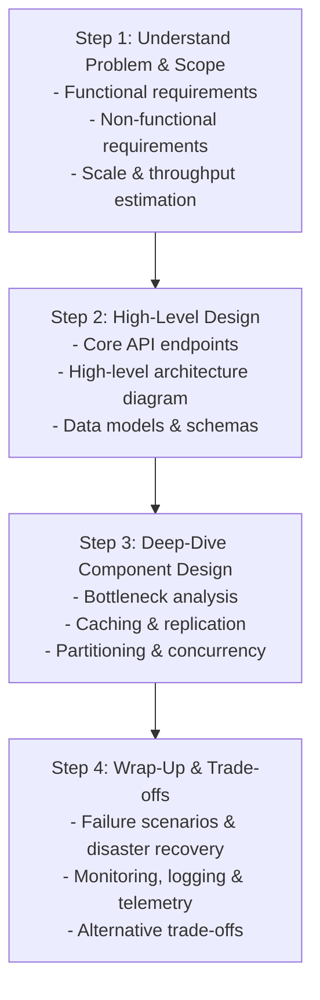

# Comprehensive System Design Guide & Projects

A structured, practical repository covering system design fundamentals, interview blueprints, real-world distributed architectures, and working code implementations.

---

## 📚 Table of Contents

1. [System Design Interview Framework](#-system-design-interview-framework)
2. [Core Fundamentals](#-core-fundamentals)
   - [Distributed Systems](topics/01-distributed-systems/)
   - [Networking & Communication](topics/02-networking-and-communication/)
   - [Storage & Caching](topics/03-storage-and-caching/)
   - [Asynchronous Processing & Queues](topics/04-message-brokers-and-queues/)
3. [Case Studies & Reference Implementations](#-case-studies--reference-implementations)
   - [Distributed Rate Limiter](architectures/rate-limiter/)
   - [Scalable URL Shortener (TinyURL)](architectures/url-shortener/)
   - [Real-Time Notification Service](architectures/notification-service/)
4. [Cheatsheet & Quick References](#-cheatsheet--quick-references)
   - [Interview Cheatsheet & Estimations](cheatsheet/system-design-interview-cheatsheet.md)

---

## 🎯 System Design Interview Framework

Follow this 4-step framework during system design interviews:



---

## ⚡ Key Estimations Cheat Sheet

| Metric | Rough Value |
|---|---|
| Seconds per day | $\approx 86,400 \approx 10^5$ seconds |
| 1 Million requests/day | $\approx 12$ requests/second |
| 100 Million requests/day | $\approx 1,200$ requests/second |
| 1 Billion requests/day | $\approx 12,000$ requests/second |
| Latency: L1 Cache reference | $0.5\text{ ns}$ |
| Latency: Main Memory (RAM) reference | $100\text{ ns}$ |
| Latency: SSD Random Read | $150\text{ }\mu\text{s}$ |
| Latency: Cross-Datacenter Round Trip | $150\text{ ms}$ |

---

## 🚀 Getting Started

Clone the repository:

```bash
git clone https://github.com/Sujan4646/system-design.git
cd system-design
```

Explore case studies and run reference implementations:

```bash
# Test Rate Limiter Implementation
python architectures/rate-limiter/rate_limiter.py

# Test URL Shortener Implementation
python architectures/url-shortener/url_shortener.py
```
